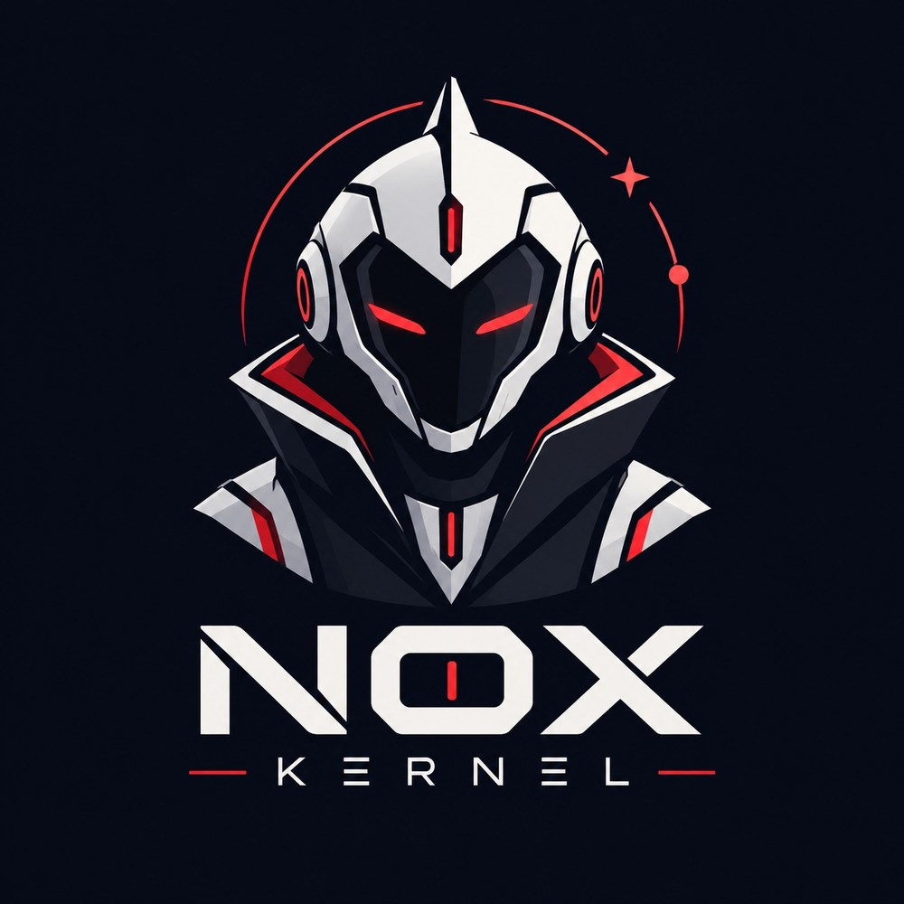

  

<h1 align="center">NOX KERNEL</h1>

  <strong>AI Systems &nbsp;·&nbsp; Cybersecurity &nbsp;·&nbsp; Infrastructure &nbsp;·&nbsp; Hardware</strong>

<em>Independent developer. Building to understand.</em>

---

### About

I'm **NOX** — an independent developer exploring the systems behind modern computing and machine intelligence.

I learn by building, experimenting and figuring out why things work (and why they sometimes don't). This GitHub is a record of that process: practical experiments, useful tools and lessons worth sharing.

### Current focus

- **AI engineering** — autonomous agents, tool use, orchestration, evaluation and reliability.
- **Local AI** — model inference, quantisation, hardware efficiency and hybrid deployments.
- **Cybersecurity** — secure design, defensive research, threat modelling and system hardening.
- **Infrastructure** — Linux, virtualisation, containers, networking and self-hosted services.
- **Hardware** — compact compute, GPUs, embedded systems and physical-world interfaces.

### The workbench

Expect small prototypes, reproducible experiments, benchmarks, technical notes and open-source contributions as they're ready.

Not everything here will be polished. The aim is to understand the technology, document the process and keep improving.

---

Build. Test. Learn. Repeat.
